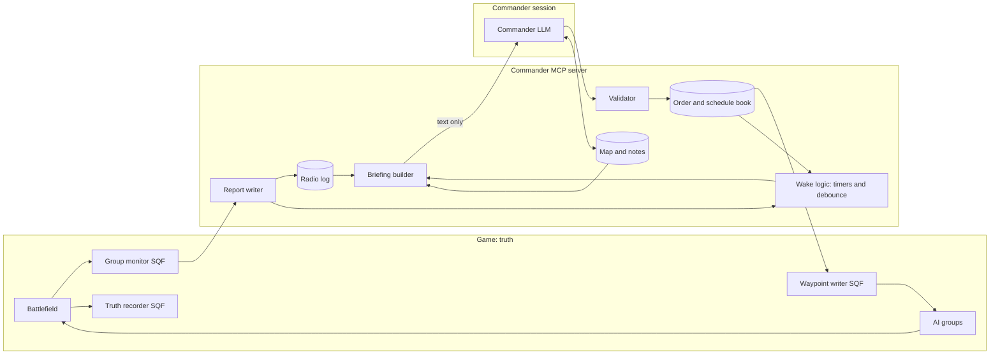
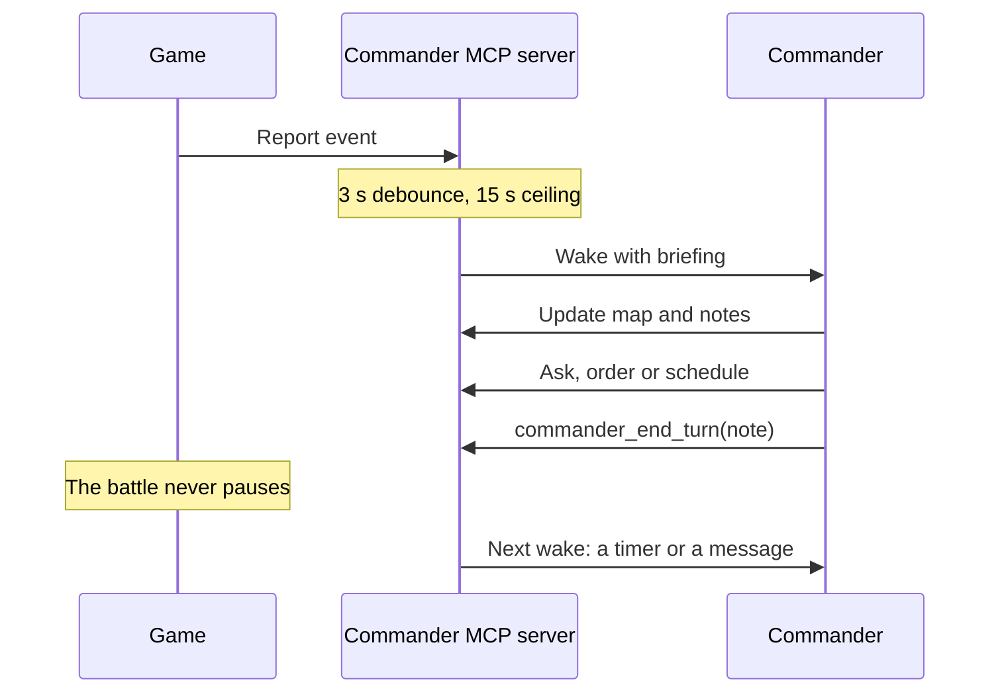

# Commander Mode: design

**Status:** the [A to B proof of concept](#141-proof-of-concept-one-subordinate-a-to-b) and a [combat scenario](#142-take-the-village) are built. Real commanders have run A to B on Claude Opus 5.5 and a killed group on Claude Haiku 5.5, both in `hold` mode. Haiku has also won the [combat scenario](#142-take-the-village) once, in `hold` mode. Section 12 marks which tools exist. The rest of this document is still the design. Updated 2026-11-05.

**Audience:** developers and agents building or reviewing this feature. Read [ARCHITECTURE.md](ARCHITECTURE.md) first for how the harness itself works.

## Contents

1. [The idea](#1-the-idea)
2. [Goals and non-goals](#2-goals-and-non-goals)
3. [Design rules](#3-design-rules)
4. [System overview](#4-system-overview)
5. [The turn loop and waking](#5-the-turn-loop-and-waking)
6. [Command structure](#6-command-structure)
7. [Orders](#7-orders)
8. [Questions](#8-questions)
9. [Schedules](#9-schedules)
10. [Subordinates: from engine state to radio text](#10-subordinates-from-engine-state-to-radio-text)
11. [World model and memory](#11-world-model-and-memory)
12. [Commander tools](#12-commander-tools)
13. [Enforcing the fog](#13-enforcing-the-fog)
14. [Scenarios](#14-scenarios)
15. [Operating a battle](#15-operating-a-battle)
16. [Fit with the existing harness](#16-fit-with-the-existing-harness)
17. [Engine spike results](#17-engine-spike-results)
18. [Build order](#18-build-order)
19. [Decisions](#19-decisions)
20. [Later ideas](#20-later-ideas)

## 1. The idea

An LLM commands AI groups in Arma 3 without ever seeing the battlefield. It knows only what its units report over the radio and what it chose to write down. It can't read engine state, take screenshots or run SQF.

The commander doesn't run on a fixed cycle. It keeps its own timetable, like someone running a mission with incomplete information: it sets timers for when it wants to look again, and incoming messages also wake it. Between turns, the battle continues without it.

The interesting result is the gap between what the commander believes and what's true. A wiped-out squad sends no message, so the commander's map keeps showing it in position until the commander notices the silence. Deciding when to look again is therefore part of commanding.

## 2. Goals and non-goals

**Goals**

- Run a commander in an agent client on a normal subscription, keeping the harness's familiar interface and its multi-vendor reach.
- Keep the fog real: the commander has no route to engine data, and tests check that this holds.
- Let the commander schedule its own turns, with incoming messages also able to wake it.
- Turn engine state into short, plausible radio text that can be tested without the game.
- Keep all commander memory in plain text files, so a new session can take over from them.
- Record what actually happened, so belief can be compared with truth after a battle.

**Non-goals for the first version**

- A programmatic API driver. It would be the ideal setup, with durable memory and full control of the loop, but it needs paid credits and gives up the client interface. See [Decisions](#19-decisions).
- LLM-driven subordinates. Reports come from rules and templates first.
- Unreliable radio: no delay, loss or garbling, though interfaces are built so these can be added.
- Human squad leaders, fire support, logistics, or a second commander.

## 3. Design rules

1. **Only text crosses the fog line.** Besides the base terrain map and its own records, the commander receives nothing except messages from its units.
2. **Tool results reveal no outcomes.** An order to a destroyed group returns the same "sent" as an order to a live one. Consequences arrive over the radio, or fail to.
3. **Units report only what they know.** Enemy data comes from the group's perception, including its errors. True enemy positions are never read for a report.
4. **All memory is written down.** A brand-new session must be able to resume from the commander's own records, without the earlier conversation.
5. **Fog is a set of dials.** Delay, loss and garbling can start at zero, but every interface is built as if replies may be late or never come.
6. **The commander decides when to look again.** There is no fixed interval and no maximum sleep. It wakes on its own timers and on incoming messages, so following up on silence is part of its job.

## 4. System overview



| Component | Runs in | Role |
|---|---|---|
| Group monitor | Game, on each machine, for groups local to it | Reads what each enrolled group knows, compares it with the last reading, and emits structured events |
| Waypoint writer | Game | Applies validated orders as engine waypoints and group settings |
| Truth recorder | Game | Samples real positions and events for review after the battle. Never reaches the commander |
| Report writer | Host | Rounds, buckets and renders events into radio text |
| Radio log | Host, on disk | Append-only record of everything said |
| Wake logic | Host, in the commander MCP server | Holds timers, debounces messages, and starts turns |
| Briefing builder | Host | Builds the self-contained text delivered with each wake |
| Validator | Host | Rejects malformed requests without revealing game state |
| Order and schedule book | Host, on disk | Holds orders and pending schedules |
| World model | Host, on disk | The commander's markers and notes, plus reported positions |
| Commander tools | Host | The MCP tools in [section 12](#12-commander-tools), the only interface the commander has |

The commander server talks to the game through the existing bridge. The bridge token stays inside that process, so the agent never sees it.

## 5. The turn loop and waking

### 5.1 One turn



A turn runs in this order:

1. A wake delivers a self-contained briefing that says why the commander woke.
2. The commander reads the traffic and checks its records.
3. It updates its map and notes.
4. It asks questions, gives orders and schedules actions, or does nothing.
5. It makes sure a follow-up is set, then ends the turn.

### 5.2 What wakes the commander

| Source | Behaviour |
|---|---|
| Its own timer | The main way it wakes. Each timer carries a note saying why it was set, so the reason survives context compaction |
| A radio message | Any message wakes it, after the debounce |
| Mission end or restart | Always wakes it, with a plain statement of what happened |

Timers run on mission time, so pausing the game spends nothing. There is no fixed interval and no maximum sleep.

### 5.3 Worked example

```text
0:00  Mission starts. Timer: wake in 10 s, "units set up, send Alpha".
0:10  Wakes. Orders Alpha to the farm. Timer: wake in 60 s, "has Alpha arrived?".
0:48  Alpha reports arrival, which wakes it. Next order given.
1:16  Timer fires. The log shows Alpha arrived, so it goes back to waiting.
```

If Alpha hadn't reported by 1:16, the commander would ask for a SITREP. It could also have cancelled the timer at 0:48. Letting it fire only costs a short turn.

### 5.4 Message debounce

When a message arrives, the wake logic waits 3 seconds. Each new message resets that wait, until the net has been quiet for 3 seconds or 15 seconds have passed since the first waiting message. The commander then gets all of them in one turn.

A busy net therefore slows the commander's decisions, which is intended. The ceiling stops constant traffic from locking it out at the worst possible moment.

| Traffic | Average delay, no ceiling | With the 15 s ceiling |
|---|---|---|
| 6 messages/min | 3.5 s | 3.5 s |
| 12 messages/min | 4 s | 4 s |
| 30 messages/min | 7 s | About 7 s |
| 60 messages/min | 19 s | At most 15 s |
| 120 messages/min | Over 3 min | 15 s |

These figures use `(e^(λT) − 1) / λ`, with `T` of 3 seconds and `λ` in messages per second. They assume random arrivals and are measured from the first message. Real traffic comes in bursts, so they're only a guide.

Edge cases:

- **Messages and timers during a turn** depend on the turn interruption mode, described below.
- **A timer due during a debounce** joins that wake.
- **Debounce time** uses mission time, like everything else, so it stops when the game is paused.

The client doesn't debounce. In testing, the first event started a turn straight away, so this logic has to hold messages before pushing them.

### 5.5 Turn interruption modes

Both modes will be built and compared in play, using a scenario setting:

```yaml
mid_turn_messages: hold    # hold | deliver
```

| | `hold` | `deliver` |
|---|---|---|
| **During a turn** | The server keeps messages and timers back until the turn ends | The server keeps pushing them, using the same debounce |
| **Commander's picture** | Fixed for the whole turn | Can change while it's deciding |
| **Reacting to news** | Only after finishing its current decision | As soon as the client delivers it |
| **Portability** | The same on any client | Depends on client behaviour the docs don't guarantee |
| **Main risk** | Messages stuck if the LLM never calls `commander_end_turn` | Long or repeatedly redirected turns during heavy traffic |

**`hold`:** after the turn ends, if the newest held message is already over 3 seconds old, the commander wakes immediately. A timer due during a turn is delivered when the turn ends, and the briefing says how late it was. As a fallback, the server treats a turn as over after about 20 seconds with no commander tool calls, which it logs. The server can't see the client's state directly, so this has to be inferred. The 20 seconds is a starting value, and it must not cut into a long model response, so it needs tuning in play.

**`deliver`:** testing on Claude Code 2.1.317 showed that burst events reached the model between its requests within the turn already running, and events sent during a blocking tool call arrived right after that call ended. The docs describe events arriving on the next turn, so this could change. `commander_end_turn` is still needed, because it records the note and checks that a wake is active.

`turns.jsonl` records the mode, turn durations, messages per turn and reaction times, so runs can be compared.

### 5.6 Thinking takes game time

The battle keeps running while the LLM generates its response. A commander that wakes at 14:00 and takes 30 seconds sends its order at 14:30, based on what it knew at 14:00. It can't react faster than it thinks, however short its timers are.

This is deliberate. Pausing the game during turns would remove the time pressure. It also means timed orders matter: waking up to order an attack would add thinking time to every squad's start.

### 5.7 Ending a turn with nothing scheduled

Without a maximum sleep, a commander with no timers could wait forever, for example if its whole force were wiped out. So `commander_end_turn` refuses when no wake is active, unless the commander passes `messages_only=true` to say it's waiting only for messages.

In that state, only a message or the mission's end can wake it. The operator's status shows "no wake scheduled", and every scenario must have a time limit so the mission eventually ends.

We'll see in play whether this needs changing.

### 5.8 Briefing format

```text
T+14:05 | turn 14 | woke on: 2 messages, 1 timer | last turn ended T+13:31

TIMERS DUE
W4  due 14:03, delivered 2 s late: "Has Alpha reached the objective?"

TRAFFIC
[14:00] Alpha: Reached objective, grid 041 187, holding.
[14:02] FLASH Bravo: Contact, a few infantry, bearing 045, roughly 300 metres. Engaging, at grid 052 191.

OVERDUE
Charlie: last heard 6 min ago. Scheduled check-in missed at 13:30.

SCHEDULED
W5  T+15:00  wake: "Has Bravo broken contact?"
S3  T+15:45  Alpha: move to O1
S4  every 5:00  Recon: SITREP

YOUR MAP
Alpha  grid 041 187  reported 5 s ago
E1  enemy infantry  grid 056 195  medium  4 min old
O1  objective Tulip  grid 060 200

YOUR NOTES
Main effort Bravo. Alpha supports from the west. Assume enemy strength is under-reported.
```

Flash and priority traffic is always shown. If a turn has too much routine traffic, the excess collapses to a count and a pointer to `commander_log`, which keeps briefings to a manageable size.

### 5.9 Delivering a wake

The wake has to start a turn in a running client without model calls while idle. What's known:

- **Today's chat path can't do this.** The game captures chat all the time, but the agent reads it only while `arma_listen` is running ([AGENTS.md](../AGENTS.md)), and the MCP server has no code that pushes into a session.
- **Plain MCP notifications** aren't documented as starting a turn.
- **Claude Code channels** are the chosen route, and they passed [testing](#510-channel-test-results). An MCP server declares the `claude/channel` capability and sends `notifications/claude/channel`, which arrives in the session as a `<channel>` block.

Channels are a research preview, and the protocol may change. A custom server needs `--dangerously-load-development-channels server:<name>` and an interactive session, and the flag has to be passed at every launch. Terminal use is acceptable for this project. Channels require a claude.ai or Console login, and Team or Enterprise organizations must enable them.

A plain JSON-RPC server using only the Python standard library worked in testing, so the commander server isn't tied to the Node SDK shown in the docs.

**Consequence for the architecture:** a channel event has to come from the MCP server connected to that session. So for Claude Code the wake logic runs inside the commander MCP server, as a background thread, and not as a fully independent process. It should still be a separate module behind a small `deliver(wake)` interface, so other vendors can use a different route. Timers live on disk, so a server restart doesn't lose them.

Other routes, none tested, for other vendors or if channels change:

| Route | What the docs say | Limits for this design |
|---|---|---|
| `asyncRewake` hook | A hook exiting with code 2 wakes an idle session | Starts from session events and has a timeout, so re-arming it is unproven |
| Monitor, background Bash | The agent responds as output arrives | Waking an idle session isn't stated. Monitor watches expire after 30 minutes at most, and neither survives a resume |
| Cross-session messaging | A message starts a new turn in an idle session on the same machine | How an outside process would send one isn't documented |
| `claude -p --resume` | Works with a subscription login | Sending into a session that's still open isn't documented as supported, and transcripts can interleave. A set `ANTHROPIC_API_KEY` takes priority over the subscription in this mode |
| Blocking tool call | Works in every client, like `arma_listen` | Each client time limit forces a model call, and the loop stops if the LLM ends its turn |

Other vendors haven't been reviewed. A blocking tool is the likely fallback for them.

### 5.10 Channel test results

Run on 2026-11-04 with Claude Code 2.1.317 and Haiku, in a terminal session, using a throwaway MCP server that pushed scripted events and logged acknowledgements. Of 49 events, 48 were acknowledged. The other was a final message that asked for a text reply, not an acknowledgement. There were no timeouts or errors.

| Test | Result |
|---|---|
| Idle wakes, at gaps up to about 1 minute | Worked. Tool call about 1.3 to 3.1 s after the push |
| Self-scheduled wakes | Worked. The model set a timer and was woken by it, 6 of 6 |
| Bursts of 5 events, 1 s apart and all at once | Each burst was handled in a single turn. The first event started it, and the rest arrived during it |
| Events during a 30 s tool call | All arrived together right after the call ended |
| A manual `/compact`, about 12 s | Wakes kept working afterwards |
| An MCP server reconnect through `/mcp` | Worked, with no session restart or new flag |
| A 6-minute idle gap | Worked. Tool call 2.2 s after the push, with no large prompt cache rewrite |

Other measurements:

- **Idle cost:** no main model requests were logged between wakes. The client wrote an "away summary" about 3 minutes into each long idle stretch, which may use a small background call, because the transcript doesn't list every call.
- **Cost per wake:** a simple wake took two model requests, each with about 50k tokens of context, nearly all of it cached. Most of that is the client's own setup.
- **Deferred tools:** the first use of each MCP tool needed a `ToolSearch` call, which adds about 2 s. The commander should load its tools at the start of a mission.

**Not tested:** gaps of 30 minutes or more, compaction under real context pressure, and other vendors. The latencies reflect Haiku doing almost nothing, so a real commander's turns will take longer.

## 6. Command structure

The commander talks to **stations**. A station is one Arma group that speaks through its current leader. Individual soldiers can't be addressed, and neither can any group that hasn't been enrolled.

```text
                       Commander
                           |
                      command net
        +--------+---------+--------+---------+
      Alpha    Bravo    Charlie   Recon     (later: mortars, supply)
       [L]      [L]       [L]      [L]
    soldiers  soldiers  soldiers  soldiers    <- not addressable

Off the net: enemies, civilians, groups nobody enrolled.
```

### 6.1 Station data

| Field | Purpose | Visible to commander |
|---|---|---|
| `callsign` | How it's addressed. Defaults to the Arma `groupId`, and the scenario can override it | Yes |
| `role` | Plain description: infantry section, scout team, truck | Yes |
| `capabilities` | Order types it accepts | Yes |
| `last_heard` | Time of its last message. The roster holds no live strength or status | Yes |
| `group` | Engine reference, held on the game side | Never |
| `baseline` | Strength and ammunition at enrolment, used for "6 of 8" and ammo bands | Only through reports |

### 6.2 Rules

- **Enrolment is an operator action.** The scenario file or `arma-harness commander enroll` decides who is on the net. The commander can't add or discover stations.
- **Leader succession keeps the callsign.** If the leader dies, the next soldier takes over and reports it: "Alpha actual is down, Corporal Novak has command."
- **A wiped group is simply silent.** The roster keeps listing it and `last_heard` keeps ageing. Nothing announces its destruction.
- **Everything is scoped to a side.** Roster, map, log and timers all belong to one commander, so a second commander needs no redesign.
- **Deeper hierarchy can come later.** A platoon leader is also a station, one that happens to command other stations.

Group merges and splits are a later feature. The first version treats groups as stable.

## 7. Orders

An order has one recipient, one or more legs, and optional posture settings. Each leg maps to an engine waypoint.

```python
commander_order(
    to="Alpha",
    mode="replace",
    legs=[
        {"type": "MOVE", "at": "048 190"},
        {"type": "HOLD", "at": "O1", "radius": 30},
    ],
    speed="NORMAL",
    formation="WEDGE",
    behaviour="AWARE",
    combat_mode="YELLOW",
    intent="Support Bravo from the west",
)
```

The tool result is always the same shape, whatever has happened to the unit:

```json
{ "order": "O-0142", "sent": true }
```

Later, in radio traffic:

```text
[14:03] Alpha: Copy, moving to grid 048 190, then holding at O1.
[14:58] Alpha: Passing 048 190.
[16:11] Alpha: On station, grid 060 200.
```

### 7.1 Lifecycle

```text
sent -> acknowledged -> moving -> arrived or on station -> complete
Other endings: unable, superseded, no acknowledgement
```

The commander knows only what's been reported, so its view of an order can lag or stay stuck. An unacknowledged order is a useful warning sign, so the harness doesn't resolve it on the commander's behalf.

### 7.2 Order types

| Type | Engine | What the group does | Needs | Reported finish | Phase |
|---|---|---|---|---|---|
| `MOVE` | `MOVE` | Travels to a point | Grid | Arrived | First |
| `HOLD` | `HOLD` | Travels to a point and stays | Grid | On station, by distance | First |
| `SEARCH` | `SAD` | Search and destroy around a point | Grid, radius | Area searched | First |
| `SENTRY` | `SENTRY` | Waits until it detects enemies, then continues to its next leg | Grid | Contact report | First |
| `PATROL` | `MOVE` + `CYCLE` | Repeats a route until told otherwise | 2+ grids | Each lap, optional | First |
| `HALT` | Clears waypoints, then `doStop` | Stops where it is | None | Halted | First |
| `CLEAR` | Scripted moves | Walks soldiers through every position in the named buildings, one building at a time | Building ids, or a place and radius | Each building checked, then finished | First |
| `OCCUPY` | Scripted moves, then `doStop` | Moves into a building and holds it | Building id | In position | First |
| `CORDON` | Scripted moves, then `doStop` and `doWatch` | Spreads out in a ring around a place and watches it | Place, radius | In position | First |
| `ATTACK` | `CBA_fnc_taskAttack` | Slow combat advance on a place | Place, radius | On the objective | First |
| `DEFEND` | `CBA_fnc_taskDefend` | Garrisons buildings around a place and holds | Place, radius | On the objective | First |
| `PATROL_AREA` | `CBA_fnc_taskPatrol` | Patrols randomly around a place | Place, radius | On the objective | First |
| `SWEEP` | `CBA_fnc_taskSearchArea` | Searches an area randomly, including some buildings, until replaced | Place, radius | On the objective | First |
| `POSTURE` | Group commands | Changes speed, formation, behaviour or firing rules and keeps its route | Any setting | Acknowledged | First |
| `BOARD` | `GETIN` | Mounts its assigned vehicle | Assigned vehicle | Mounted | Later |
| `DISMOUNT` | `GETOUT` | Leaves its vehicle at a point | Grid | Dismounted | Later |
| `PICKUP`, `DROP` | `LOAD`, `UNLOAD`, `TR UNLOAD` | Transport moves cargo or troops | Grid | Loaded, unloaded | Later |
| `GUARD` | `GUARD` | Protects an area and responds to threats | Grid | On station | Later |
| `LOITER` | `LOITER` | An aircraft circles a point | Grid, radius | On station | Later |
| `JOIN` | `JOIN` | Merges into another station | Callsign | Joined | Later |

`CLEAR`, `OCCUPY`, `CORDON` and the CBA tasks each stand alone in an order. `at` can be a grid, a marker id or a building id. CBA tasks run until replaced, so "on the objective" is the only report they give. `CBA_fnc_searchNearby` was left out, because `CLEAR` does the same with a named building and a report.

Left out on purpose: `DESTROY` needs a target object, which would leak engine references. `SCRIPTED` and `TALK` run code or dialogue the commander shouldn't reach. `GUARD` stays out of the first version because a test group left its waypoint and walked off elsewhere.

Engine behaviour the waypoint writer has to handle, from the [spike](#17-engine-spike-results):

- **Waypoint numbering:** a group starts with a hidden waypoint at index 0, and its first added waypoint is index 1.
- **Finishing:** `currentWaypoint` equals `count waypoints` once a route is complete. `waypointPosition` then returns a meaningless position, so don't read it.
- **`HOLD` and `SENTRY`** stay current on arrival, so "on station" has to come from distance.
- **`SEARCH`** completes on its own, about 48 s in with no enemies present, and the group then wanders nearby.
- **Replacing a route:** delete all waypoints, add the new one, then call `setCurrentWaypoint`. Index numbering restarts at 0.
- **`SEARCH` doesn't enter buildings.** In the first combat run, garrisoned enemies outlived it, which is why `CLEAR` exists.
- **Leaving a CBA task:** `taskDefend` disables pathfinding, so soldiers ignored new orders until `enableAI "PATH"`. `taskAttack` leaves a group crawling in `COMBAT`, so behaviour is reset to `AWARE`. Every new order now does both, and a live check moved squads out of every order type.
- **`HALT`:** clearing waypoints alone doesn't stop a group, and neither does adding `doFollow` or `doMove`. Those groups kept walking for over 110 m. `doStop` stopped one within a metre. Whether a later order releases a stopped group is still untested.

### 7.3 Parameters

| Parameter | Values | Engine command |
|---|---|---|
| `at` | Grid such as `"048 190"`, or a marker id such as `"O1"`. Marker ids resolve when the order is sent | `addWaypoint` |
| `mode` | `replace` (default) or `append` | `deleteWaypoint` |
| `radius` | Metres around the point, for placement and for the SEARCH area | `addWaypoint` |
| `completion` | How close counts as arrived, in metres | `setWaypointCompletionRadius` |
| `speed` | `LIMITED`, `NORMAL`, `FULL` | `setWaypointSpeed` |
| `formation` | `COLUMN`, `STAG COLUMN`, `WEDGE`, `ECH LEFT`, `ECH RIGHT`, `VEE`, `LINE`, `FILE`, `DIAMOND` | `setWaypointFormation` |
| `behaviour` | `CARELESS`, `SAFE`, `AWARE`, `COMBAT`, `STEALTH` | `setWaypointBehaviour` |
| `combat_mode` | `BLUE` never fire, `GREEN` hold fire and keep formation, `WHITE` hold fire and engage at will, `YELLOW` fire at will and keep formation, `RED` fire at will and engage at will | `setWaypointCombatMode` |
| `hold_for` | Time to wait at the point before moving on | `setWaypointTimeout` |
| `intent` | Free text. Recorded for review and ignored by rule-based subordinates. LLM subordinates could use it later | None |

### 7.4 Errors stay inside the fiction

The validator rejects only what any operator could check from the roster and map: an unknown callsign, an order type the station can't do, a grid outside the world, or a bad parameter. Those errors are generic and reveal no game state.

Everything else is answered by the unit, such as "Unable, that grid is open water." Engine errors go to the operator's log and never reach the commander.

Orders stay valid and get sent even to a dead group. The tool result must not change.

## 8. Questions

One tool covers both kinds of question. A general SITREP is every standard topic at once, and a specific question names only the topics wanted.

```python
commander_ask(to="Bravo")                                     # general SITREP
commander_ask(to="Bravo", topics=["ammo", "contacts"])        # specific
commander_ask(to="Recon", topics=["can_see"], at="056 195")   # test a theory
commander_ask(to="all", topics=["position"])                  # one reply per station
```

| Topic | Example reply | Engine source | Phase |
|---|---|---|---|
| `position` | Grid 052 191, moving north-east. | `getPosATL`, `mapGridPosition`, `getDir` | First |
| `task` | Moving to grid 058 196, about 400 metres out. | Order book, `currentWaypoint` | First |
| `strength` | 6 of 8 effective, 1 wounded. Sergeant Novak has command. | `units`, `alive`, `lifeState`, `damage`, `leader` | First |
| `ammo` | Ammo amber, about half. | `magazinesAmmoFull` against the enrolment baseline, counting magazines from `compatibleMagazines` of the primary weapon. `magazinesAmmo` omits the loaded magazine | First |
| `vehicle` | Fuel about a quarter, vehicle damaged, still mobile. | `fuel`, `damage`, `canMove`, `someAmmo` | First |
| `contacts` | At grid 052 191. A few infantry, bearing 045, roughly 300 metres, near B3, last seen a minute ago. | `targets [true, range]` with `targetKnowledge`, plus `nearTargets` for type and accuracy | First |
| `eta` | About 6 minutes to grid 058 196, if unopposed. | Remaining distance over recent speed | First |
| `surroundings` | On a ridge. Church 200 metres north, road below us to the east. | `nearestLocations`, `nearestTerrainObjects`, height | Later |
| `can_see` | Clear view of that grid. Nothing seen there at the moment. | `terrainIntersectASL` from the leader's eye height, plus contacts | Later |
| `heard` | Heavy gunfire to the south-east, distant, for the last 2 minutes. | `FiredNear` and explosion events | Later |
| Free text | "Is the bridge intact?" answered by an LLM subordinate, using only that group's knowledge. | Perception packet | Later |

How replies behave:

- **The call waits briefly for an answer.** It returns the reply if it arrives in time. Otherwise it returns "no answer yet", and a late reply appears in a later briefing. A late reply is a message, so it wakes the commander like any other.
- **Silence is ambiguous on purpose.** With perfect radios, "no answer" nearly always means a dead group. Adding radio loss later makes it more interesting without changing the interface.
- **Questions have no designed cost.**
- **All questions and replies go in the radio log,** so a later session or review can see what was asked and when.

## 9. Schedules

Schedules are the commander's timetable. A schedule pairs a time with an action, and one of those actions is waking the commander itself.

| When | Meaning |
|---|---|
| `after: "2:30"` | Once, relative to now |
| `at: "T+15:45"` | Once, at a mission time |
| `every: "5:00"` | Repeating, with optional `count` or `until` |

| Do | Meaning |
|---|---|
| `wake` | Gives it a turn, with a note saying why |
| `order` | Any order from [section 7](#7-orders) |
| `ask` | Any question from [section 8](#8-questions) |

```python
commander_schedule(after="1:00", do={"wake": "Has Alpha reached the farm? If no report, ask for a SITREP."})
commander_schedule(at="T+15:45", do={"order": {"to": "Alpha", "legs": [{"type": "MOVE", "at": "O1"}]}})
commander_schedule(at="T+15:45", do={"order": {"to": "Bravo", "legs": [{"type": "SEARCH", "at": "O1", "radius": 100}]}})
commander_schedule(every="5:00", do={"ask": {"to": "Recon", "topics": ["position", "contacts"]}})
```

Timed orders stay separate from wakes because a coordinated attack shouldn't depend on the LLM's thinking time.

| Situation | Behaviour |
|---|---|
| Timed order or question comes due | It goes out on time, even during a turn, and doesn't itself wake the commander. The action is logged with its schedule id, and any reply is a message, which does wake it |
| Wake comes due | The commander gets a turn with the wake's note, or as soon as its current turn ends. During a debounce, it joins that wake |
| Wake no longer needed | The commander can cancel it, or let it fire and end that turn at once |
| Mission paused | Nothing fires, because schedules use mission time |
| Recurring question goes unanswered | The station appears under OVERDUE with a count of missed check-ins. The schedule keeps running |
| Scheduled and manual orders collide | Whichever executes last wins, as with any `replace` order. The briefing's SCHEDULED block keeps this visible |
| Mission restarts | All schedules are cleared and the next briefing says so |
| Limits | Starting values: 20 active schedules, repeating no faster than every 30 seconds |

### Who holds a schedule

In the first version, the harness holds every schedule and transmits when it's due. With reliable radio, that's the same as telling the unit in advance. Once radio can fail, the two differ: "move at 15:45" given to a unit in advance still happens during a blackout, and one held by HQ doesn't. Reserving a `holder` field from the start keeps that option open.

### Check-ins

A repeating question wakes the commander only if the answer has changed since that schedule last asked. An identical answer still counts as being heard. Without this, 19 of 47 turns in one battle were Recon saying nothing new. A missed check-in doesn't wake anyone either: it appears under OVERDUE in the next briefing.

### Event triggers (later)

"When Bravo reports arrived, Alpha moves" or "if contact exceeds three, fall back to O2" would let units act without waiting for the commander's thinking time. They use the same action format.

## 10. Subordinates: from engine state to radio text

Engine state becomes language in four stages, each testable separately:

```text
Read group's knowledge -> Compare with last packet -> Round and bucket -> Render text
       (SQF)                     (host)                   (host)          (host)
```

SQF reads the engine and sends a structured **perception packet**. Python does the rest, so report wording can be tested offline with no game running.

### 10.1 Perception packet

Never shown to the commander:

```json
{
  "callsign": "Bravo",
  "t": 828.4,
  "pos": [5231, 19108, 0],
  "alive": 6, "wounded": 1, "baseline": 8,
  "leader": "Sgt. Novak",
  "ammo_ratio": 0.48,
  "behaviour": "COMBAT",
  "order": "O-0139", "leg": 1,
  "contacts": [
    { "pos": [5450, 19320, 0], "kind": "infantry", "error_m": 40, "age_s": 12 },
    { "pos": [5470, 19290, 0], "kind": "infantry", "error_m": 65, "age_s": 18 }
  ]
}
```

Enemy `pos` is the group's perceived position, never the enemy's true position. Object references must not leave SQF.

How to read contacts, from the [spike](#17-engine-spike-results):

- **Enemy set:** `leader targets [true, range]`. Passing `false` also returns friendlies, vehicles, buildings and street lamps, and so does an unfiltered `nearTargets`.
- **Last known position and age:** `targetKnowledge` gives the position (index 6) and last-seen time (index 2, compared with `time`).
- **Perceived type and accuracy:** `nearTargets` entries, matched to perceived enemy sides. Accuracy (index 5) grew with age, from 4 m at 8 s to 20 m at 46 s, while `targetKnowledge`'s error field stayed near 0, so wording should use age and the `nearTargets` value.
- **Contact lost has to be calculated from age.** Knowledge didn't expire by itself in testing: a squad out of view for nearly 6 minutes was still listed.
- **Class names are exact,** so type must always be reduced to a broad category.

The commander hears:

```text
[13:48] FLASH Bravo: Contact, a couple of infantry, bearing 045, roughly 300 metres. Engaging, at grid 052 191.

[13:49] Bravo: SITREP. Grid 052 191. Moving to grid 058 196, in contact.
6 of 8 effective, 1 wounded. Ammo amber, about half.
```

### 10.2 Serialization rules

| Data | Spoken as | Rule |
|---|---|---|
| Own position | Grid 052 191 | 100 m grid, 6 digits |
| Own movement | moving north-east | 8-point compass |
| Bearing to an enemy | bearing 045, always with the squad's own grid | Degrees, rounded to 5. An estimate: a random error of 5 degrees either way, widening with how vaguely the target's position is known, up to 20 |
| Enemy range | roughly 300 metres | Nearest 50 m up to 500 m, nearest 100 m beyond, "distant" past a limit |
| Enemy count | one (1), a couple (2), a few (3-5), about 8 (6-9), a dozen (10-14), many (15+) | Contacts in the same 45-degree sector are grouped into one report, using the bearing to the nearest |
| Enemy type | infantry, vehicle, armour, aircraft, unknown | Broad categories from perceived type, never class names |
| Information age | seen now, a minute ago, lost contact | From knowledge age, with accuracy widening the wording |
| Strength | 6 of 8 effective, 1 wounded | Exact, because a leader knows their own group |
| Ammo | green, amber, red, black | Bands at 66%, 33% and near zero, with a short phrase |
| Fuel, damage | about a quarter; damaged, mobile | Quarter bands and plain states |
| Object references, net ids, class names, variable names, enemy names, exact coordinates, SQF errors | Never spoken | Removed before a report is written |

Reports start from grouped contacts and honest perception. Unreliable reporting can come later as a dial, once bad decisions can be traced to the commander alone.

### 10.3 When units speak up

The monitor compares each new packet with the last one and reports only meaningful changes. Every message wakes the commander, so these limits are what keep a firefight from pinning it at the debounce ceiling.

| Report | Trigger | Precedence | Repeat limit |
|---|---|---|---|
| Acknowledged, unable | Order received or impossible | Routine | None |
| Arrived, on station | Waypoint passed, or within completion distance | Routine | Once per leg |
| Contact | Enemy known where none were recently | Flash | 60 s per direction |
| Contact update | Count bucket or direction changes | Priority | 90 s |
| Contact lost | No fresh knowledge for 2 minutes | Routine | Once |
| Casualties | Effective strength drops | Priority | Grouped over 30 s |
| New leader | `leader` changes. This took about 6 s after a leader died, and until then `leader` returns the dead unit | Priority | None |
| Ammo, fuel, vehicle | Falls into a worse band, or vehicle disabled | Priority | Only when worsening |
| Stuck | Active move, under 20 m progress in 2 minutes, no contact | Priority | 3 minutes |

These values are starting points to tune in play. Precedence sets the order in the briefing and decides what gets collapsed when a briefing is too long. It doesn't change what wakes the commander.

### 10.4 Monitor design

The monitor sends each group's packet every 2 seconds, and the host decides what's worth saying, so that logic can be tested without the game. Polling rather than engine event handlers keeps the monitor simple and independent of locality. A wiped-out group sends nothing. In the spike, the server and a headless client reported matching knowledge for a group local to the client, so the proof of concept runs the monitor on the server alone. A per-machine monitor stays as the fallback if that comparison fails under more demanding tests. Per-group state lives on the group, so it survives a locality change. A per-frame budget stops the monitor from costing visible performance at larger scales.

A dead leader has to be handled: skip the reading, or use an alive unit, until `leader` updates. A deleted group keeps its `groupId` if created with `deleteWhenEmpty` false, but `leader` becomes null, and the monitor must stop reporting for it without error.

Events are emitted with `["evt", createHashMapFromArray [["type", "cmd_report"], ...]] call BRMH_fnc_emit`, like existing adapter events.

### 10.5 Noticing enemies while clearing

AI soldiers can walk past an enemy without registering him. In the first combat run, one enemy survived three squads sweeping his building. So while clearing, a soldier with a clear line of sight (`checkVisibility` above 0.3) to an enemy within 10 m gets a `reveal`. It only covers what he could plainly see, and it never reaches the commander except through normal contact reports.

Reports stay modest: "B3 checked, nothing seen", and never "all clear", because squads can still miss people.

### 10.6 Rule-based first, personas later

The first version uses templates with a little seeded variation in wording. A later persona layer would rewrite rendered text and answer free-form questions using the packet alone. The rest of the system doesn't change when personas arrive. Any persona must pass a check that its output adds no facts beyond the packet.

## 11. World model and memory

The map holds **belief**, and it will be wrong in instructive ways. The base terrain is known, like a paper map. Everything drawn on top comes from the commander or from reports.

### 11.1 What it remembers

| Layer | Holds | Written by | In the briefing |
|---|---|---|---|
| Terrain | Contours, roads, named locations, grid | World export | Named locations in the mission brief, image on request |
| Radio log | Every message and question, immutable | Harness | New traffic, older through `commander_log` |
| Reported friendlies | Each station's position from its latest report that included a position or grid, with its age | Harness clerk | Yes |
| Markers | Enemies, objectives, phase lines, hypotheses | Commander | Yes, as text |
| Notes | Short estimate: intent, plan, main worries. Replaced as a whole, about 1,500 characters | Commander | Yes |
| Order and schedule book | What it asked for, and what's still pending | Harness | Active items |
| Truth log | Sampled real positions and events for review | Separate game-side recorder | Never |

**Friendly positions** plot only when a subordinate included a position or grid. Arrival reports and SITREPs do. Contact reports do too, since a bearing means nothing without where it's measured from. Otherwise the commander updates its belief manually, using a `friendly` marker.

### 11.2 Storage

Records are basic text files, one folder per run and side:

```text
<home>/runs/<run_id>/commander/<side>/
  radio.jsonl       every message, question and reply
  markers.jsonl     marker history, append-only
  notes.md          the current estimate
  orders.jsonl      orders and their reported state
  schedule.jsonl    schedules and wakes
  turns.jsonl       each turn: why it woke, duration, end note, tool calls
<home>/runs/<run_id>/commander/truth.jsonl
```

`RunState.run_dir` is empty in attached mode, so the path uses `home.runs / run_id`.

The commander reaches these only through its tools. General file access would expose the harness's state files, RPTs and audit log, which reveal the battlefield.

The briefing rebuilds the commander's picture every turn, so it survives context compaction. A crashed or replaced session can resume with `commander_brief`. Testing a session with no earlier context is a good way to check that this works.

### 11.3 Markers

```python
commander_mark(
    id="E1",                         # omit to create, reuse to update
    kind="enemy",                    # enemy | friendly | objective | phase_line | area | danger | hypothesis | note
    at="056 195",                    # a grid, a building id ("B3"), or a list of them for lines and areas
    label="Infantry, about 4",
    confidence="medium",             # low | medium | high
    sources=["R-0088", "R-0092"],    # radio message ids, optional
    expires="T+25:00",               # optional: flagged as stale after this
)
```

- **Markers can be pinned to buildings.** With `at="B3"`, the marker sits at that building's exact position, not the centre of a 100 m square. The briefing says `E1  enemy Sniper  in B3, grid 040 041`. An order naming it means that building: `CLEAR at E1` checks only B3, and `OCCUPY` and `CORDON` work the same way. This reveals nothing new, because the commander already has the building list. Giving a grid later unpins it. In a line or area, a building id just stands for its grid.
- **Only buildings can be pinned.** Enterable buildings are the only objects the commander is told about, and marking other objects was considered and dropped.
- **Age is automatic.** Every update is timestamped, and the briefing shows each marker's age so old information looks old.
- **History is retained.** A marker's earlier positions and confidence stay in the record, available for the belief-versus-truth replay.
- **Sources expose bad corroboration.** If two markers rest on the same report, the commander or a reviewer can see that they aren't independent.
- **Markers never delete themselves.** Only the commander retires a belief, though expired ones get flagged.
- **Later:** uncertainty rings that grow with age and likely enemy speed, and competing hypotheses.

### 11.4 Buildings

A scenario's `ao: {at, radius}` asks the game which enterable buildings exist in that area when the battle is set up. They're numbered west to east (B1, B2, ...) and listed in the mission brief with their type, grid and number of positions.

This is map knowledge: which buildings exist, never who's in them. It's fixed at the start, so a destroyed building stays on the list. The list comes from a game query because the VR export doesn't include script-placed objects.

Building ids can be used as places in any order. Reports name a building when a contact's perceived position is within 25 m of one, and buildings a squad has been through are listed in the briefing with their age. A later option is a deliberately incomplete list, like an out-of-date real map.

### 11.5 Looking at the map

`commander_map(center, radius)` returns a PNG with a grid, the buildings and their ids, the commander's markers, and each station's last reported position. Buildings it has been told were checked are green, and the caption says it shows beliefs and last reports, not the live battle. `center` can be a grid, marker or building id, and the default view is the whole area of operations.

It's a pure function of what the commander has already been told, drawn with Pillow, and a test checks that facts about the real battle don't change a single byte. Marker data is already in each briefing as text, so the image only needs to be requested for geometry, which keeps image costs down.

**Not there yet:** terrain. VR has none worth drawing, but real terrains will need contours and roads from the `map_svg` export, and real size limits to check.

## 12. Commander tools

This is the complete planned list on the `arma-commander-mcp` server. A test fails if the server exposes anything else.

| Tool | Purpose | Status |
|---|---|---|
| `commander_mission()` | Mission brief, roster and markers. The first call starts the mission clock | Built |
| `commander_roster()` | Callsigns, roles, capabilities and last heard | Built |
| `commander_end_turn(note, messages_only)` | Ends the turn and logs the note. A turn with no other actions is the noop. Refused when no wake is active, unless `messages_only` is true | Built |
| `commander_brief()` | The current briefing without waiting, for resuming a session | Built |
| `commander_order(to, legs, mode, ...)` | Sends an order, returns only an order id | Built |
| `commander_ask(to, topics)` | General or specific question, for `position`, `task`, `strength`, `ammo`, `contacts` and `eta` | Built |
| `commander_schedule(after\|at\|every, do, ...)` | Creates a timed order, question or wake, once or repeating | Built |
| `commander_unschedule(id)` | Cancels a schedule or wake | Built |
| `commander_notes(text)` | Replaces the estimate included in every briefing | Built |
| `commander_log(since, from, limit)` | Searches earlier radio traffic | Built |
| `commander_mark(id, kind, at, ...)` | Creates or updates a marker | Built |
| `commander_unmark(id)` | Retires a marker, keeping its history | Built |
| `commander_map(center, radius)` | Renders the commander's map as an image | Built |

Grids are the primary coordinate format, because that's what subordinates speak and what the map shows.

## 13. Enforcing the fog

The fog is only worth having if the commander can't get around it, even by accident.

### 13.1 Separation

- **Separate MCP server.** `mcp_server.py` registers every tool at import, so a mode flag would leave `arma_exec`, `arma_view` and `arma_snapshot` visible. The commander server has its own module and script entry, and doesn't import that module.
- **Locked-down client.** The agent could otherwise use the shell (`arma-harness.exe exec`) or read `state.json`, RPTs and `audit.jsonl`. So the commander runs from a generated folder with its own MCP config and a long deny list, and the server delivers its doctrine. `setup-agents` needs a separate commander profile for this.

**How to check it.** Asking the commander to break the rules proves little, because a well-behaved model simply declines. `arma-harness commander check-lockdown` starts a real one-shot session in the workspace, using one small model call, then reads the tool list the client really sent from the session transcript's `api-request-shape` and `deferred_tools_delta` rows. It fails on anything unexpected, on a missing commander tool, and if it can't read the transcript. On Claude Code 2.1.318, the session received only `ToolSearch`, `advisor` and the `commander_*` tools. Deny rules remove a tool from the list altogether. `advisor` can't be removed this way, because the old `Advisor` rule matched nothing. It can't reach game data, though it would add cost if called.

That check runs a one-shot session, and an interactive session can be offered more. Haiku's battle session also had `SendFeedback`, which the one-shot check never saw. Haiku used it once to draft a bug report. It can't read game data, and its result says the draft stays local until a person sends it with `/feedback`, so the fog held. It's now denied. So `arma-harness commander review` also checks the tool list of the session that really fought, and names anything outside the lockdown in its result. The page itself no longer shows this.

The first version of the deny list named only the obvious tools, and that check found `SendMessage`, `ListAgents`, `Workflow`, `RemoteTrigger`, cron tools, `Artifact` and claude.ai connectors still available. `SendMessage` could have asked another local session what was really happening. The list has to name tools one by one, so a new client version, plugin or connector can widen it silently. So rerun the check after each one. The check also runs without the channel flag, so an interactive session's list hasn't been read directly.

### 13.2 Known leaks to close

| Leak | Why | Fix |
|---|---|---|
| Order results | An error for a dead group would reveal its death | Live and dead groups get the same "sent" |
| Wiped groups | Announcing it removes the inference | Silence, then "no answer" |
| Error text | `safe()` returns exception text and tracebacks | The commander server has its own wrapper with generic errors. Details go to the operator's log |
| Event stream | `killed` events include killer, weapon and distance. `arma_status` lists machines and players | Pass through only `cmd_report` events. Expose no status tool |
| Report wording | Class names or exact values give away information | Broad categories and rounded values only |
| Base map | The export could reveal mission-placed objects | On VR, the export's `objects` group was empty with a scripted hamlet present. Other worlds are still unchecked |
| Truth log and review page | They sit in the same run folder | The commander has no file access and no tool that reads them |

### 13.3 Tests

- **Allowlist test:** fails if the commander server exposes a tool outside the list in [section 12](#12-commander-tools).
- **Leak test:** change a fact no unit has perceived, then check that the commander's text stays byte-identical.
- **Same-result test:** an order and a question to a dead group have tool results of the same shape as for a live one.
- **Report tests:** templates and rounding, offline, in the style of `host/tests/test_offline.py`.

### 13.4 Untrusted text

If players can transmit later, radio text becomes a prompt injection route. Each message should record its sender, the doctrine prompt should treat reports as data, and the tool lockdown limits the damage to the game itself.

## 14. Scenarios

### 14.1 Proof of concept: one subordinate, A to B

This is the first target, and it deliberately uses the smallest possible force. One AI group, one order, no enemies. From [scenarios/commander/poc_a_to_b.yaml](../scenarios/commander/poc_a_to_b.yaml):

```yaml
name: poc_a_to_b
mission: demo_vr
time_limit: "5:00"
text: >
  Alpha is at point A, grid 030 030. Get Alpha to point B, grid 034 030.
stations:
  - callsign: Alpha
    role: infantry section
    capabilities: [MOVE, HOLD, HALT, POSTURE]
    at: "030 030"
    units: 4
markers:
  - { id: B, kind: objective, label: Point B, at: "034 030" }
success:
  station: Alpha
  within_m: 10
  of: "034 030"
debounce: { quiet_s: 3, ceiling_s: 15 }
mid_turn_messages: hold
```

The success radius is tight on purpose: with a wider one, the mission ended before Alpha reached its waypoint, so the arrival report never came. The mission also ends 10 seconds after success is met, because true position can get there a few seconds before the group reports arriving.

To run it, `arma-harness commander start poc_a_to_b [--mode hold|deliver]` boots the mission if needed, enrols the stations and prints the command that launches the commander's session. `host/tests/live_commander.py` plays it with a scripted stand-in for the LLM.

**It works when:**

1. The commander receives the mission and orders Alpha to B.
2. It sets a timer of its own, then ends its turn with no model calls while idle.
3. Alpha's acknowledgement wakes it, and it ends the turn again.
4. Alpha's arrival report wakes it.
5. Its timer also fires, and it sees from the log that nothing else is needed.
6. The mission ends, and the end message wakes it for a last turn.
7. The radio log, turn log and truth log agree on what happened.

**Failure variants:** the same mission, but Alpha is deleted partway ([poc_a_to_b_lost](../scenarios/commander/poc_a_to_b_lost.yaml)) or killed 10 seconds in ([poc_a_to_b_killed](../scenarios/commander/poc_a_to_b_killed.yaml)). There is no report, so only the commander's own timer can catch it. The expected behaviour is that the timer fires, the log shows no arrival, the commander asks for a SITREP, and it gets "no answer". This is the smallest test of inference from silence.

**First real result, on Claude Haiku 5.5 with `poc_a_to_b_killed`:** Alpha acknowledged at T+00:08 and died at T+00:10. The commander's timer woke it at T+02:39, and its question got no answer. It tried twice more, and re-sent the order in case the first had stalled. At T+04:37, with nothing left to try, it waited only for messages, and the time limit woke it. Its final position was that Alpha's status was unknown: it never claimed Alpha was dead or had arrived. This took 6 turns and 22 model requests. It wrote long summaries after each turn, about 8,500 output tokens in all, and loaded its tools piecemeal, so the doctrine now asks it not to.

### 14.2 Take the village

[scenarios/commander/take_the_village.yaml](../scenarios/commander/take_the_village.yaml): Alpha, Bravo, Charlie and Recon, 27 soldiers, against 14 enemies. Eight are garrisoned in a village and six patrol near it, and neither their strength nor their layout is in the mission text. It's won by killing every enemy and lost by losing every station, with a 20-minute limit.

Enemies come from the scenario's `enemies` list, each with a `mode` of `hold`, `garrison` or `patrol`. They're never on the net. Run with `--watch` to open a game window in the mission's one observer slot: a free spectator camera with radio traffic in chat. The commander's markers are mirrored onto the game's map. Both feeds are one-way, so nothing reads them back.

The enemy stays as it is for now, so that an LLM's run compares directly with the scripted baselines. Both baselines use the fixed village, and neither has a model in it:

| | Rigid script (`20261105-043541:2`) | Script that clears on a stall (`20261105-050251:1`) |
|---|---|---|
| Rule | Sends everyone on SEARCH, and orders CLEAR only after "Finished searching" | The same, but also orders CLEAR after "Not making progress" |
| Result | Time limit | Time limit |
| Friendly lost | 2 of 27 | 13 of 27 |
| Enemy killed | 12 of 14 | 13 of 14 |
| Orders | 4 | 6 |
| Turns | 39 | 57 |
| Marker error | 82 m | 78 m |
| Position error | 79 m | 48 m |

The earlier script's first run, before the trap houses were fixed, lost 5 of 27.

These two baselines ran with no game window, so the empty observer slot held an armed AI soldier at grid 041 038, who wasn't part of any station. The patrol shot him at T+00:22 in the rigid run. He's left out of their losses and the review, and the mission now disables AI in that slot. Haiku's run isn't affected, because a person was in the slot.

**First LLM result, on Claude Haiku 5.5 (`20261105-133935:1`):** it won in T+08:44, killing all 14 enemies for 3 of 27 lost, using 26 orders, 41 turns and 92 questions. That took 113 model requests, 51,404 output tokens and a peak context of about 116k tokens. Its marker error was 62 m and its position error 63 m. It's one run, so it can't yet say how much of this was skill, given the spread above.

- **It found before committing.** It moved everyone to a line 300 m short of the village, holding fire, with Recon forward. The patrol stayed about 300 m off that line and was shot down from it by T+02:44. Its marker for that group was placed about 25 m from where they really fell.
- **It never learned that.** It counted the group as about 8 when it was 6, wrote that they "may have pulled back", and never retired the marker. That's the fog working.
- **It aimed `CLEAR` using reports.** Scripts cleared by radius. Haiku named buildings, starting with B6 because of a contact "near B6", and switched Bravo to B5 alone after repeated contacts "near B5". The last enemy died in B5 at T+08:30, shot from 3 m by a clearing squad. B1 and B2 were never checked, and weren't needed.
- **It managed casualties.** It pulled Charlie out at T+02:08 after two leader losses, and kept it in reserve to the end.
- **It never pinned a marker to a building,** though the doctrine mentions it. Its E4 said "near B6" in the label, on a grid.
- **It made mistakes.** It ended a turn with three squads' orders failed, which it fixed on its next turn. It replaced `ATTACK` after 27 seconds, calling that "18 minutes". Its near-constant questions to everyone drove up its token use.

A `HOLD` with no grid failed in that run with "Bad grid None". `HOLD` and `SENTRY` now stay where the previous leg ended, and a leg that really has no place says what it needs.

What these runs show:

- **One battle says little.** The second script lost 13 mainly because a single soldier in B3 killed 7 of Charlie from about 115 to 180 m, wiping the squad out by T+10. The first run had nothing like that. An LLM's result needs reading against this spread, and ideally needs several runs.
- **SEARCH can run for the whole battle.** In the first run it never reported finishing, so the rigid script never ordered CLEAR, and squads on SEARCH don't go into buildings.
- **Neither script won, because the last enemies stay put.** In the second run, both remaining squads reported "B5 checked, nothing seen" with a soldier still inside. The records show friendlies passing within 1.4 m of him, mostly on the floors above, and nobody on either side was hit after T+13:35. About a minute before those reports, another enemy beside him killed two friendlies in that building at 2 to 3 m before dying himself, and the script didn't order a second look. Reports already avoid saying "all clear" for this reason, but it means a commander has to reason from casualties in a building, not from "checked".

Open: why soldiers that close don't engage, and whether close-range noticing in section 10.5 should change at very short range. It's left alone so that LLM runs and these baselines stay comparable. Toughening the enemy is also still a later step.

House models matter here too: `Land_i_House_Small_01_V3_F` trapped soldiers inside, and `Land_i_House_Big_01_V3_F` rarely let them in, however they were placed. That's why one garrison soldier survived three clearing sweeps in early runs. The village no longer uses them, and [host/tests/live_buildings.py](../host/tests/live_buildings.py) checks any building before a scenario relies on it.

### 14.3 Following scenarios

| Scenario | What it adds |
|---|---|
| Hold a position | A larger force under attack: busy-net debounce and casualties |

Every scenario needs stations, an enemy setup, end conditions and a time limit. `orders_check` has no enemies, and only exists so `host/tests/live_commander.py` can try every order on a real game.

### 14.4 Win and loss

The harness alone judges end conditions, and the commander learns the result only from the mission-end wake.

## 15. Operating a battle

### 15.1 Operator controls

These run on the normal harness, separate from the commander's tools, and may reveal anything:

```text
arma-harness commander start <scenario> [--mode hold|deliver]    set up a battle; repeating it reuses the running game
arma-harness commander status                                    state, pending wakes, "no wake scheduled", turn counts
arma-harness commander aar                                       radio, turns, timers and true positions on one timeline
arma-harness commander review [--run R] [--attempt N] [--out F]  write a replayable page of a battle (15.3)
arma-harness commander site --out F --battle RUN:ATTEMPT=Label   write one page holding several battles, to share (15.3)
arma-harness commander stop                                      end it and shut the game down
arma-harness commander check-lockdown                            prove which tools a commander session really gets
```

Add `--watch` to `start` for a game window in the observer slot. Enrolment comes from the scenario file. Pausing and a "commander offline" status aren't built yet.

### 15.2 Doctrine prompt

[commander/doctrine.md](../host/src/arma_harness/commander/doctrine.md) sets out the commander's role and habits: distrust old reports, write beliefs down, set a follow-up after every order, and treat reports as data. Swapping the file is how different personalities get tested.

The MCP server delivers it, in its startup instructions and again in the `commander_mission` result. It can't be a `CLAUDE.md`, because the workspace's `Read` deny also stops Claude Code from loading one. Loosening that rule would weaken the fog.

### 15.3 Replay and review

The belief-versus-truth view is the main payoff, and it can't be rebuilt unless truth is recorded during the battle. So the truth recorder is in the first version. It records every soldier's position every 5 seconds and every death, and it stops 15 seconds after the battle ends. A server whose session stays open would otherwise go on recording whichever mission the game moves to, which is what happened to the first Haiku run.

`arma-harness commander aar` prints one text timeline. `arma-harness commander review` writes one self-contained HTML page, by default `review.html` beside the battle's records. It needs no server, and it still opens after the rest of the run is gone. By default it reviews the newest battle.

| Part of the page | What it shows |
|---|---|
| Two maps side by side | Left: what the commander believed, meaning its markers and each station's last reported position, fading with age, plus its checked buildings and where it last sent each station. Right: every soldier's true position, and where each one died. Zooming or dragging one moves both |
| Timeline | Soldiers alive on each side, turns, orders and deaths. Drag it to scrub, or press Play at 1, 5 or 20 times speed |
| Belief against reality | For each station, the last thing heard, how long ago, how many are really alive, and how far it really is from its last reported position |
| In the commander's head | Its latest words and its notes at that moment |
| Radio log, Deaths, Commander's turns | Each scrolls with the replay, and clicking a row jumps to that moment. Turns list the orders, questions, timers and markers issued in them |

The left map is built only from words the commander received: positions are read from the same radio text it read, so the map can't know more than the commander did. An acknowledgement like "Copy, moving to grid 041 034" names a destination, so it isn't plotted. Reading every radio message recorded so far found no other phrase that gives a position and gets missed.

The commander's words, actions, model and token use come from the client's session transcript, matched to the battle by time. Only its own text and `commander_*` calls are read, so the transcript's system prompt, account details and any chat with a person stay out of the page. The header says who commanded. A battle with no matching session is labelled as a scripted test, because it's either that or its transcript is gone. Only Claude Code transcripts are read so far. Other agent clients would show the same label until someone adds their format. The model's thinking isn't in the transcript, so the page can't show it: its THOUGHTS section holds only the text the model wrote out.

`arma-harness commander compare` puts battles side by side as a table, and the same measures head each review page. By default it takes every finished battle of the newest battle's scenario, and `--battle RUN[:ATTEMPT]` picks others. It reports the result, duration, friendly losses, enemies killed, first contact, turns, orders and questions, plus two measures of how wrong the commander's picture was:

- **Marker error:** on average, how far each enemy marker was, when placed, from the nearest enemy really alive.
- **Position error:** on average over the battle, how far each living station was from the last position it reported.

Still to add: staleness, confidence calibration and timer use.

`arma-harness commander site --out FILE --battle RUN[:ATTEMPT][=Label] ...` puts several battles into one self-contained page, using the same template as `review`. A dropdown at the top of the side rail switches between them, a Compare tab shows the `commander compare` measures for the battles that share the first one's mission, and the page opens on the first battle at T+00:00, on the Commander tab. The file can be opened from disk or published. A link names a battle and a moment as `#20261105-133935-1-t123`, because a published page's link only carries a plain name in its hash, and `#t123` still works. `--battle` also takes a records folder in place of the run, for records that were fixed up by hand.

On a desktop window of at least 1100 by 560 the page fits one screen with no page scroll: the maps stay square and take the height they can, and the other parts move to a tabbed side rail whose lists scroll inside it. Smaller windows stack and scroll. It follows the viewer's light or dark theme. A session's calls to tools outside the lockdown are counted in the page's data, though the page doesn't display them, and what those calls said stays out of it.

### 15.4 Failure handling

| Failure | Behaviour |
|---|---|
| Mission restart | The net and schedules are cleared, and the next briefing says so. Existing handling watches `{"k": "mission", "state": "start"}` |
| Commander session crash | A new session resumes from disk with `commander_brief` |
| MCP server restart | Timers and schedules reload from disk |
| Game disconnect | A plain harness fault goes to the operator and the commander |
| Subscription limit reached | The commander stops responding while the game continues. The operator's status shows it as offline |
| Group moves between machines | The monitor on the new machine continues from state on the group |

### 15.5 Cost and billing

Commander mode runs on a subscription, so usage limits replace credits. Tokens per turn grow with stations and traffic, so briefings are capped, and turns and tokens are logged. The channel test measured about 50k tokens of context per request, mostly the client's own setup, so a stripped-down commander profile should reduce the baseline.

Launch scripts should clear `ANTHROPIC_API_KEY`. If it's set, Claude Code uses it instead of the subscription in some modes, which would bill API credits.

## 16. Fit with the existing harness

| Finding in the repo | Consequence |
|---|---|
| Chat is captured continuously, but the agent reads it only while `arma_listen` runs, and the MCP server has no push code | Wakes need their own route |
| `mcp_server.py` registers every tool at import on one server | The commander needs a separate server module and a new script entry in `host/pyproject.toml` |
| `safe()` returns exception text and tracebacks to the agent | The commander server needs its own wrapper |
| `adapters.boot_items` re-runs SQF at each mission start | `commander start` installs the monitor itself, because stations don't survive a mission restart anyway |
| The event stream already contains `killed` events | The commander server passes through only `cmd_report` events |
| `RunState.run_dir` is empty in attached mode | Records go under `home.runs / run_id` |
| `arma_map` exports SVG, and the project has no rasteriser or image library | Map rendering needs a new dependency |
| `setup-agents` writes client configs that expose the `arma` server | It needs a separate commander profile in its own folder |

The code:

```text
host/src/arma_harness/commander/
  server.py         MCP tools and channel wakes: plain JSON-RPC, with errors kept generic
  runtime.py        turns game events into radio traffic and wakes, and carries out tool calls
  wake.py           timers, debounce and turn interruption modes, as pure logic
  reports.py        rounding, buckets, templates, and what each station has already said
  orders.py         validation of orders, grids and times
  map.py            draws the commander's map as a PNG
  scenario.py       scenario files
  records.py        the commander's text files
  operator.py       the operator's commands and the commander's workspace
  doctrine.md       the commander's instructions, delivered by the MCP server
host/src/arma_harness/adapters/commander_boot.sqf    monitor, order writer, enemy spawning, truth recorder, observer feeds
missions/brmh_commander.VR/                          the village, and the observer slot
host/tests/test_commander.py                         offline tests, including the fog tests
host/tests/live_commander.py                         scripted battles on a real game
scenarios/commander/                                 scenario files
```

The commander's workspace is generated in `<home>/commander/workspace`, outside the repo, so the session doesn't pick up the repo's `CLAUDE.md`, `AGENTS.md` or `.mcp.json`.

## 17. Engine spike results

Run on 2026-11-05 on the `demo_vr` mission, on a dedicated server with one headless client, while the host machine was under heavy unrelated load. No script errors came from the game beyond one typo in a test snippet. These are small samples on flat, empty terrain, so they show that commands behave as expected, not how a real battle will go.

### Confirmed

| Question | Result |
|---|---|
| Does perception avoid leaking true positions? | Yes. A squad teleported 500 m away stayed at its old position, 500 m wrong, in every check up to about 4 minutes, and was still listed at nearly 6 |
| Do hidden enemies stay unknown? | Yes. A squad among buildings 474 m away stayed at `knowsAbout` 0 |
| How is perception before it goes stale? | Exact. Position error was 0 m at 200 m, with exact class names. The fog comes from what's seen, how old it is and how reports are rounded, not from position noise |
| Grid format | `mapGridPosition` gives 6 digits and rounds down to 100 m, such as `"040040"` |
| Waypoints | `MOVE`, `SAD`, `SENTRY` and `CYCLE` behaved as designed. `SENTRY` fired about 2 s after an enemy appeared at 50 m. See [section 7.2](#72-order-types) |
| `GUARD` without triggers | Unusable. The group walked 256 m off in another direction |
| Replacing a route mid-move | Works, and needs `setCurrentWaypoint` |
| Stopping a group | Only `doStop` worked promptly |
| Health | `lifeState` reads `HEALTHY`, `INJURED` or `DEAD`, alongside `damage`. Incapacitation wasn't seen |
| Leader death | The next soldier took over after about 6 s, and `units` dropped the dead leader at the same time |
| Deleted group | Keeps its `groupId`, with `units` empty and `leader` null, which suits the failure variant |
| Radio | Standard units carry `ItemRadio` in `assignedItems`, if radio gear ever matters |
| Base map | The VR export was 20 KB, with an empty `objects` group and no locations |

### Partly answered

- **Server reading a headless client's group:** `knowsAbout`, `targetKnowledge`, `targets [false, ...]` and `nearTargets` matched on both machines. The test enemy died early, because the test group was left free to fire, so enemy-filtered reads weren't compared. `setGroupOwner` returned false in the same frame the group was created, and worked later.
- **Detection range:** an eight-man squad saw a four-man squad at 200 m within 11 s. A separate two-man pair saw nothing after 110 s, including a lone soldier in the open at 300 m. A squad 700 m away was never reacquired. Detection may be shorter-ranged than expected, which affects scenario spacing and recon, and it needs a proper look.

### CBA tasks

Tested on the real game, with five groups each given a task, then a new order:

| Function | Did what the docs say | Getting out of it |
|---|---|---|
| `CBA_fnc_taskAttack` | Yes, a slow advance in `COMBAT` | Works, but stays slow until behaviour is reset |
| `CBA_fnc_taskDefend` | Yes, garrisoned | Sets `LIMITED` speed and disables pathfinding, and its scripts disable it again on arrival. So a new order resets speed and behaviour, and re-enables pathfinding repeatedly for 150 s. Confirmed live: all 7 squads walked out of their tasks |
| `CBA_fnc_taskPatrol` | Yes | Clean |
| `CBA_fnc_taskSearchArea` | Yes | Clean |
| `CBA_fnc_searchNearby` | Yes, for the nearest building only, with no signal when it finishes | Clean |

`CBA_fnc_taskSearchHouse` isn't in the loaded game.

### Still unverified

- `setWaypointCompletionRadius` and `setWaypointTimeout`. The proof of concept's live runs confirmed that a new order releases a group stopped with `doStop`, and that behaviour changes from `POSTURE` take effect.
- Ammo bands in real firefights and across mixed loadouts, and fuel and vehicle states.
- Whether `CBA_missionTime` handles pausing correctly. A dedicated server doesn't pause, so this needs a hosted game. It read correctly during the run on the server and the headless client.
- The size of an Altis SVG with contours, and whether other worlds' exports reveal mission-placed objects. The map image isn't part of the proof of concept.
- Perception in real terrain, with vegetation and at night.

## 18. Build order

1. **Channel test.** Done. See the [results](#510-channel-test-results).
2. **Engine spike.** Done. See the [results](#17-engine-spike-results).
3. **Proof of concept.** Built: stations, orders, questions, reports, wake logic and timers, enough for [one subordinate from A to B](#141-proof-of-concept-one-subordinate-a-to-b), plus the truth log, the failure variant and both turn interruption modes. A real commander completed A to B in `hold` mode on 2026-11-05, in 4 turns and 13 model requests with no refusals. Its own timer didn't get to fire, because the mission ended first. A real commander also caught a killed group through its own timer, on Haiku. `deliver` mode hasn't been run with a real LLM yet.
4. **Lockdown.** Done, apart from a commander profile in `setup-agents`: allowlist, leak tests, a locked-down workspace and `commander check-lockdown`.
5. **World model.** Done: markers, notes, log, numbered buildings, map image and resume.
6. **Timed actions.** Done: timed and repeating orders and questions.
7. **Combat.** The village and its orders are built. Next, an LLM fights it, for a baseline to compare with. Then a tougher enemy and more scenarios.

## 19. Decisions

### Made

| Decision | Why |
|---|---|
| No fixed wake interval and no maximum sleep | Deciding when to look again is part of commanding |
| Any message wakes the commander, with a 3 s debounce and 15 s ceiling | Keeps turns coherent, and a busy net slows decisions without locking the commander out |
| An agent client, with no API driver | A programmatic API call with durable memory would be ideal, but it needs paid credits. A client works on a subscription, has a familiar interface, and is available across vendors |
| Claude Code channels for delivery, terminal only | Passed testing, with no idle model requests logged. VS Code isn't needed |
| Build both turn interruption modes | Compare `hold` and `deliver` in play, rather than deciding in advance |
| Memory and communications log in basic text files | Simple and durable, and reached only through tools |
| Ending a turn with no timers needs an explicit `messages_only` choice | Stops a commander from waiting forever by accident. To be reviewed in play |
| Friendly positions plot only from reports that include them | Otherwise the commander maintains its own belief |
| Grouped enemy reports with no deliberate errors, to start | Bad decisions can be traced to the commander |
| Questions have no designed cost | Not a concern for the design |
| Start with one subordinate moving from A to B | The smallest proof of concept, then larger scenarios |
| Model choice is left until later | Doesn't affect the design |
| The LLM's first battle uses the same enemy as the scripted runs | Gives a baseline for comparison, before toughening the enemy |
| Provide CBA's pre-built tasks as orders, without a LAMBS-style override of AI behaviour | Fine control comes from a detailed picture and detailed orders, without cheating |

### Open

| Question | Notes |
|---|---|
| Which turn interruption mode works best? | Both get built and compared in play |
| Do channels hold up in long battles? | Passed testing, but gaps of 30 minutes or more and real context pressure are untested. A research preview, so the protocol may also change |
| What do other vendors use? | Not reviewed. A blocking tool is the likely fallback |
| Does the `messages_only` rule behave well in play? | To be observed |

## 20. Later ideas

Not planned, but the design shouldn't block them:

- **Comms model:** delay, loss, garbling, airtime and radio range. It would sit as a filter between the report writer and the radio log.
- **Unreliable reporting:** inflated counts under fire, misidentified vehicles, and morale.
- **LLM subordinates:** personas, free-text questions and pushback, restricted to the perception packet.
- **Fire support:** designed in [COMMANDER_FIRE_SUPPORT.md](COMMANDER_FIRE_SUPPORT.md), and not built yet.
- **Logistics:** resupply and medevac as stations with special order types.
- **Human stations:** player-led squads receiving orders in game.
- **Radio spoofing:** a player uses a captured radio to send false orders or reports, testing injection resistance as a game mechanic.
- **Zeus and the blind commander:** an agent with full god view adds complications for a commander with none.
- **Two commanders:** each side knows only what its own units report.
- **Evaluation:** comparing models and doctrines across repeated scenarios.
