# Commander Mode: formal model

The concepts of commander mode and the rules between them, independent of engine and implementation. Conformance with the code is tested by `host/tests/test_model_doc.py`.

## 1. The loop

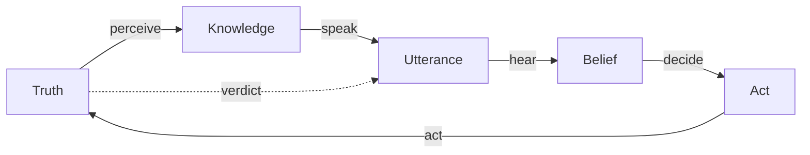

| Arrow | Signature | Owner | Error class |
|---|---|---|---|
| `perceive` | `Truth × Station → Knowledge` | Engine | Fog |
| `speak` | `Knowledge × Memory × Register → Utterance*` | Harness | Fault |
| `hear` | `Belief × Utterance → Belief` | Records, commander | Fault in the records, judgement in the reading |
| `decide` | `Belief → Act*` | Commander | Judgement |
| `act` | `Act × Truth → Truth` | Harness, engine | Fault |
| `verdict` | `Truth → Utterance` | Higher | Fault |

**Attribution.** An outcome is attributed to the first arrow, from `Truth`, whose output doesn't follow from its input. `Truth` reaching `Belief` by no arrow is a **leak**, and a fault. Fog and judgement are kept. Faults are removed.

```text
A | B   one of        A × B   both        A*   any number        A?   optional
```

## 2. Strata

```text
Stratum ::= Truth | Knowledge(Station) | Belief | Record
```

- **S1.** `Belief` changes only by `hear`, or by the commander's own `Act`.
- **S2.** `speak` reads only the station's `Knowledge`, its own orders, and handles (section 5).
- **S3.** Nothing in `Record` reaches `Belief`.
- **S4.** The result of issuing an order is independent of `Truth`.

## 3. Agents

```text
Agent   ::= Commander | Station | Higher | System | Operator | World
Station  =  Callsign × Member* × Leader          Leader: a slot, filled from Member*
```

| Agent | Addressable | Speaks | Fallible |
|---|---|---|---|
| Commander | | | Yes |
| Station | Yes | Yes | About the world |
| Member | No | Through its station | |
| Higher | No | Objectives and the end | No |
| System | No | Loss of the game, restart | No |
| Operator | No | No | |
| World | No | No | |

A station outlives its members. A session is bound to one battle.

## 4. Members

```text
Condition ::= Able | Down | Dead
Custody   ::= Lying(Place) | Carried(Member) | Aboard(Vehicle) | Treated(Member)     defined iff Down
Fate      ::= Up | Dead | Unknown
```

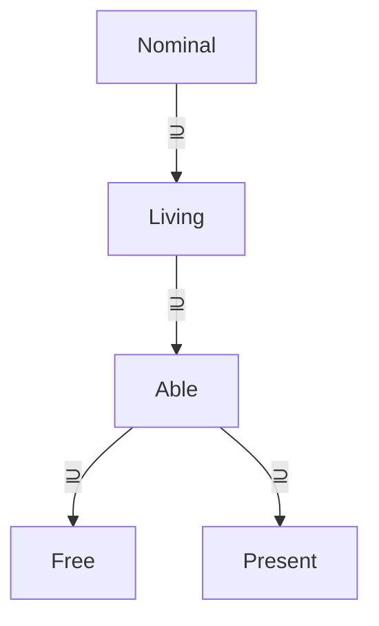

| Set | Definition |
|---|---|
| `Nominal` | initial members ∪ joined members |
| `Living` | `{m ∈ Nominal \| Condition(m) ≠ Dead}` |
| `Able` | `{m ∈ Living \| Condition(m) = Able}` |
| `Free` | `{m ∈ Able \| on foot ∧ ¬Busy(m)}` |
| `Present` | `{m ∈ Able \| Riding(m) ∨ d(m, Leader) ≤ 100 m}` |

- **M1.** Every count names its set.
- **M2.** A casualty has at most one custody at a time.
- **M3.** A casualty's `Fate` is `Unknown` to everyone out of sight of him.

```text
Asset ::= Vehicle(Seat*) | Gun(Seat*, Ammo) | Facility          a vehicle may also be a facility
```

## 5. Names

```text
Handle(T)  = an identifier on the commander's list
Listing(T) = Handle(T) × Belief(T) × Time
```

| Handle | Denotes | Issued when |
|---|---|---|
| `Alpha` | Station | Scenario |
| `V1` | Vehicle, gun | Scenario, or sighted |
| `B1` | Structure | Scenario |
| `C1` | Casualty | Reported down |
| `A1` | Facility | Built |
| `O1` | Marker | Commander, or scenario |

- **N1.** A listing holds what was last said, and its time.
- **N2.** Fire is directed by `Grid` only.

## 6. Speech

```text
Utterance   =  Speaker × Addressee × Mode × Content × Precedence × Time
Content    ::= Task | Contact | OwnForce | Assets | Effects | Place
Trigger    ::= Change | Question
Register   ::= Calm | InCombat
Precedence ::= Flash | Priority | Routine
```

| Mode | Basis | Fallible |
|---|---|---|
| Commitment | Its own order | No |
| Self-report | Its own members and assets | Rarely |
| Observation | `Knowledge` of the world | Yes |
| Projection | Measured rates | Yes, bounded: "about", "at least" |
| Refusal | Inability | No |
| Verdict | `Truth` | No |
| Procedure | The net | No |

**Register.** `InCombat ⇔` fresh contact ∨ suppression ≥ θ ∨ recent loss ∨ shelling nearby. In combat, a station withholds its own grid, delays speech in proportion to suppression, defers answers, and gives projections as lower bounds.

**Quantisation.** Every quantity is spoken at a stated resolution.

| Quantity | Resolution |
|---|---|
| Own position | 100 m grid |
| Bearing | 5°, with error |
| Range | 50 m steps to 500 m, 100 m steps to 1,500 m, then "distant" |
| Count | one, a couple, a few, about N, a dozen, many |
| Ammunition | green, amber, red, black |
| Own members apart | distance and compass point |
| Duration | minutes |

- **U1.** An unprompted utterance wakes the commander. A reply, a deferral, and an unchanged check-in don't.
- **U2.** Every unprompted utterance has a threshold or a repeat limit.

## 7. Tasks

### 7.1 Properties

```text
Lane        ::= Course | Detail | Guns | Settings
Ending      ::= Finite | Triggered | Standing | Instant
Claims       =  the members a task requires
Realisation  =  the engine mechanism; non-normative
```

| Lane | Concurrency |
|---|---|
| Course | One per station |
| Detail | Any number |
| Guns | One per gun |
| Settings | Not a task |

### 7.2 Orders

<!-- order-table -->
| Order | Lane | Ending | Claims | Realisation |
|---|---|---|---|---|
| `MOVE` | Course | Finite | All | Waypoint |
| `SEARCH` | Course | Finite | All | Waypoint |
| `CLEAR` | Course | Finite | All | Scripted |
| `MOUNT` | Course, or Detail with a seat | Finite | On foot, or one | Scripted |
| `DISMOUNT` | Course | Finite | Aboard | Scripted |
| `SENTRY` | Course | Triggered | All | Waypoint |
| `HOLD` | Course | Standing | All | Waypoint |
| `PATROL` | Course | Standing | All | Waypoint |
| `OCCUPY` | Course | Standing | All | Placing |
| `CORDON` | Course | Standing | All | Placing |
| `ATTACK` | Course | Standing | All | CBA |
| `DEFEND` | Course | Standing | All | CBA |
| `PATROL_AREA` | Course | Standing | All | CBA |
| `SWEEP` | Course | Standing | All | CBA |
| `HALT` | Course | Instant | All | Engine |
| `CARRY` | Detail | Finite | Free, one per casualty | Scripted |
| `TREAT` | Detail | Finite | Medics | Scripted |
| `AID_POST` | Detail | Finite | A medic | Scripted |
| `UNLOAD` | Detail | Finite | None | Scripted |
| `FIRE_MISSION` | Guns | Finite | Crew | Engine |
| `CHECK_FIRE` | Guns | Instant | Crew | Engine |
| `POSTURE` | Settings | Instant | None | Engine |

`All` is every member not crewing a gun.

### 7.3 Claims

- **C1.** A Course task is entitled to `All`. A Detail is entitled only to `Free` members. A casualty belongs to at most one task.
- **C2.** A task ends `Superseded` when a newer task takes a member it requires.

Consequence: a Course order supersedes the station's Details, and a Detail never supersedes anything.

### 7.4 Plans

```text
Plan ::= Task | Task ; Plan
Task ::= Trip(Waypoint+) | Order
```

- **P1.** Every step before the last is `Finite` or `Triggered`, including every waypoint of a trip.
- **P2.** `Instant` orders are single-step plans.
- **P3.** A station has at most one plan, in its Course lane. A Course order replaces it, and the station says what was dropped.
- **P4.** A plan is validated whole when issued. Each step starts when the one before it has ended `Done` or `Moot`, and a `Failed` step ends the plan.

```text
Rule     = Trigger × Act
Trigger ::= At(time) | After(duration) | Every(duration) | Finished(step)
Act     ::= Directive | Query | Wake
```

### 7.5 Life of a task

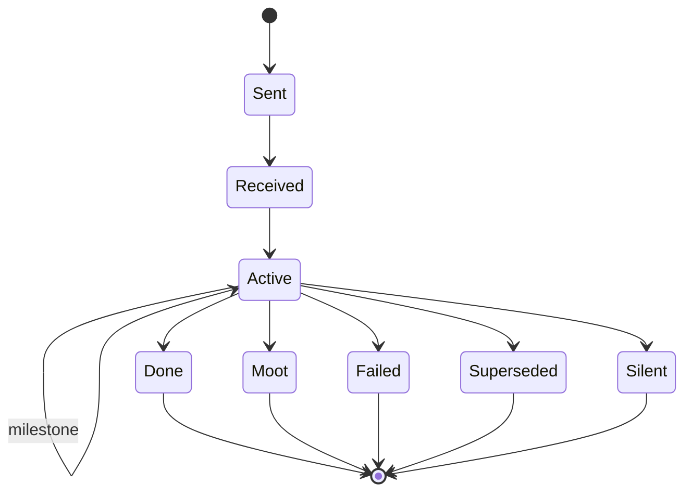

| Outcome | Meaning |
|---|---|
| `Done` | Completed |
| `Moot` | Its subject died or recovered |
| `Failed` | Impossible |
| `Superseded` | Its members were claimed (C2) |
| `Silent` | No one left to report |

- **T1.** Only `Silent` ends a task without an utterance.

## 8. Time

```text
Clock     = mission time
Attention = Turn*
Turn      = Wake × Briefing × Act* × End
Wake     ::= Timer | Messages | Notice
Briefing  : Belief × Utterance* → Text
```

- **Ti1.** Mission time doesn't wait for the commander.
- **Ti2.** `Briefing` is a function of records alone, so any session can resume a battle.
- **Ti3.** A turn ends with a timer set, or with an explicit choice to wait for messages.

## 9. Scenarios

```text
Scenario  = Station* × Asset* × Enemy* × Objective* × Failure? × TimeLimit × Event* × Dial*
Objective = Text × Predicate(Truth)
```

| Predicate | Holds iff |
|---|---|
| `AllAt(S, p, r, foot)` | `∀ m ∈ Living(S): d(m, p) ≤ r`, and if `foot`, `Living(S) = Able(S)` and none riding, and `Able(S) ≠ ∅` |
| `Eliminated` | `Able(Enemies) = ∅` |
| `Reached(s, p, r)` | `d(pos(s), p) ≤ r`, where `pos(s)` is the position of an `Able` member of `s` |
| `Lost` | `∀ s: Able(s) = ∅` |

- **O1.** An objective is confirmed when its predicate holds at the end of a grace period, and is re-evaluated until then.
- **O2.** Predicates count own members by `Living`, and enemies by `Able`: an enemy who is down is out, and an own member who is down is not.

## Appendix: state machines

Each machine as it is held in the code. A quoted state is the code's own string.

### Game side

<!-- machine: carry -->
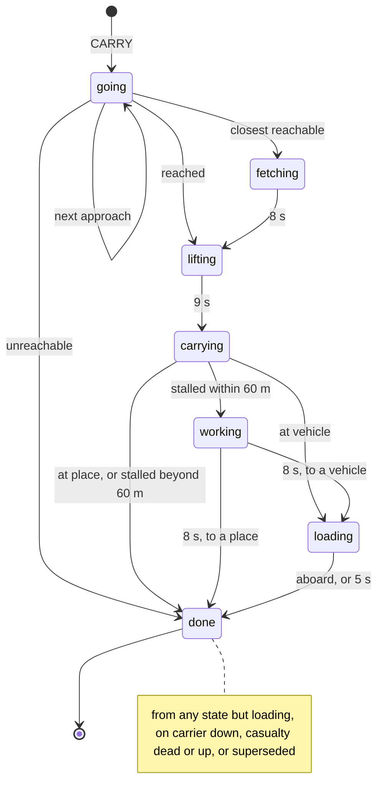

<!-- machine: treat -->
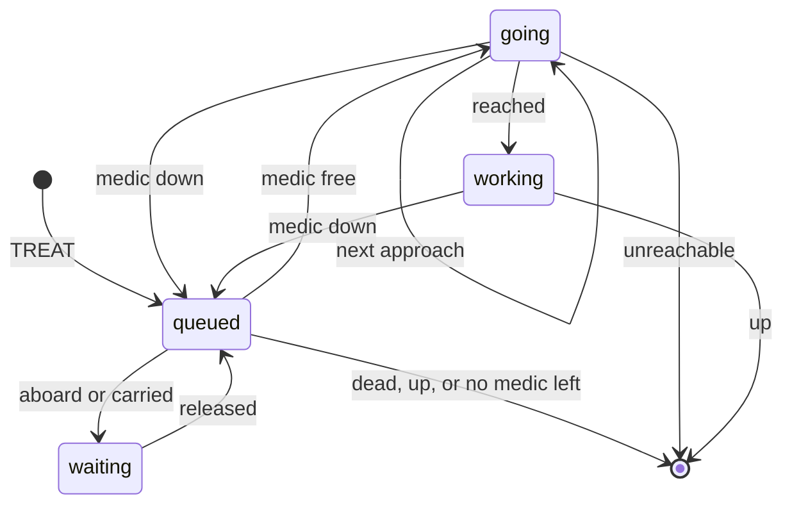

<!-- machine: post -->
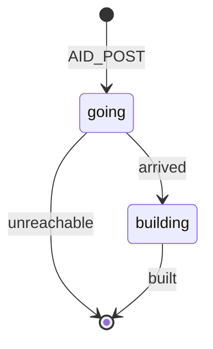

<!-- machine: fire -->
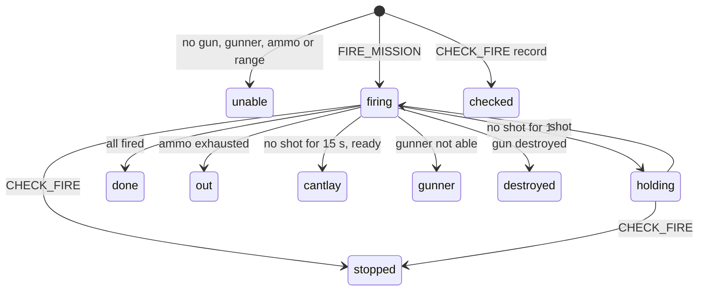

<!-- machine: boarding -->
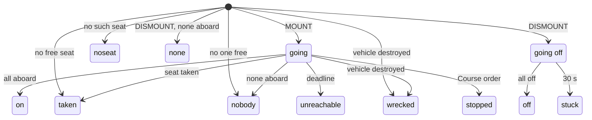

<!-- machine: clearing -->
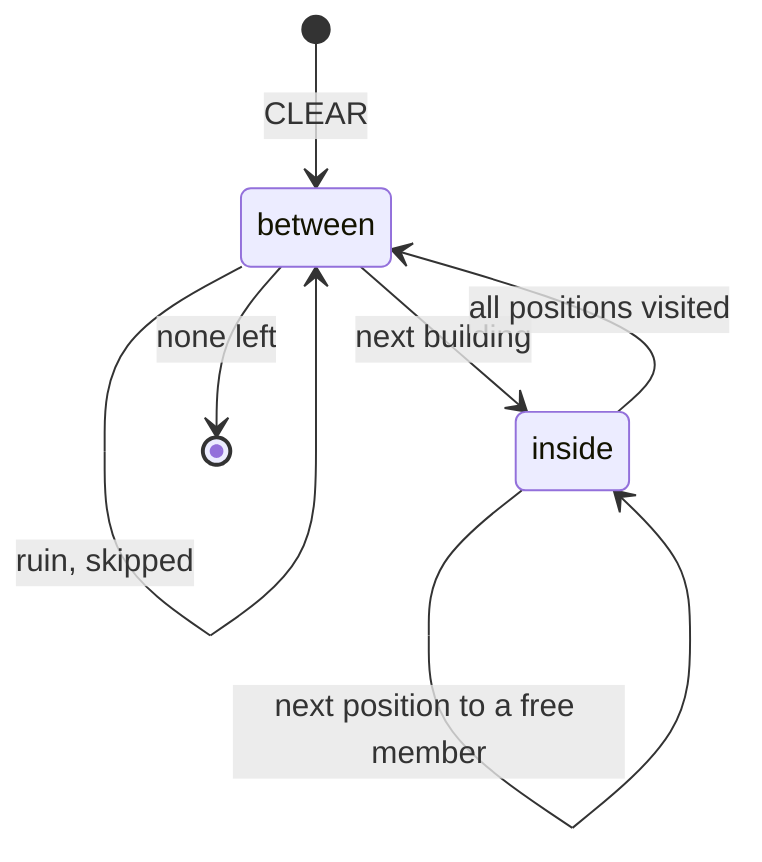

<!-- machine: placing -->
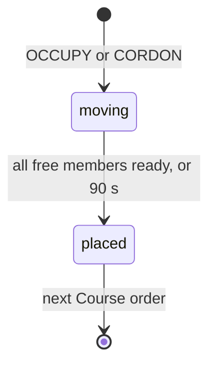

<!-- machine: cba-task -->
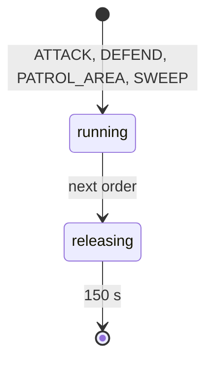

<!-- machine: custody -->
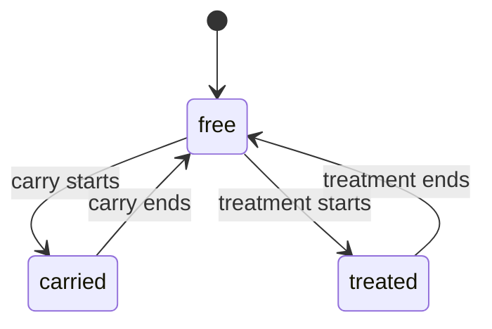

<!-- machine: busy -->
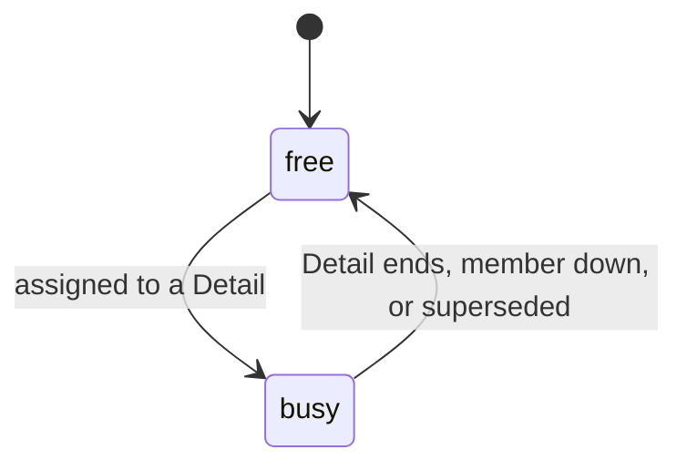

### Host side

<!-- machine: battle -->
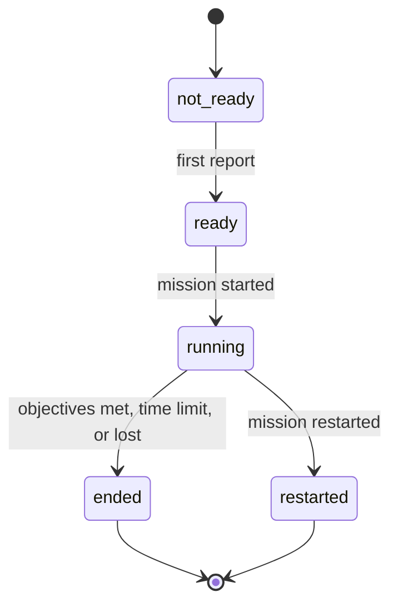

<!-- machine: attention -->
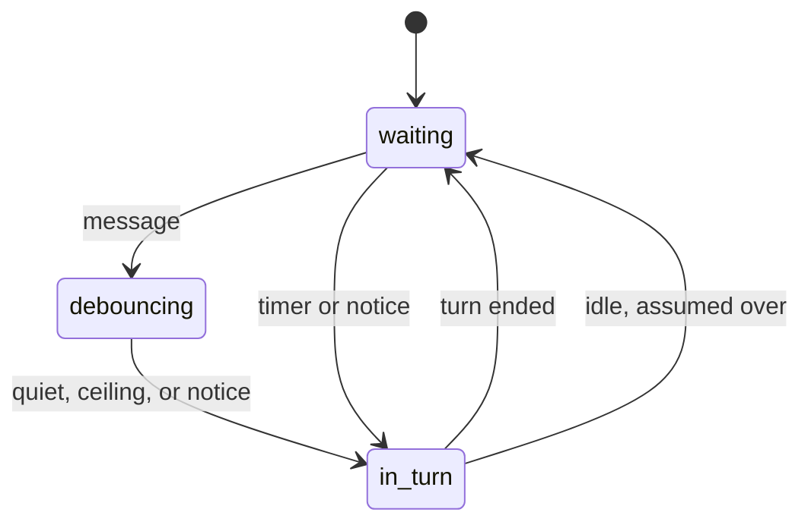

<!-- machine: chain -->
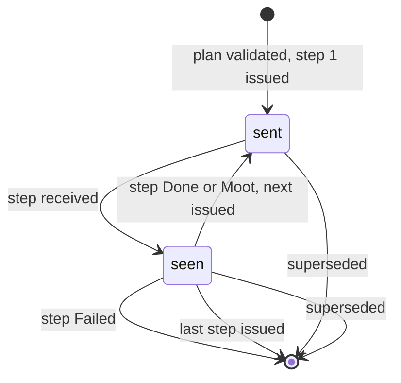

<!-- machine: objective -->
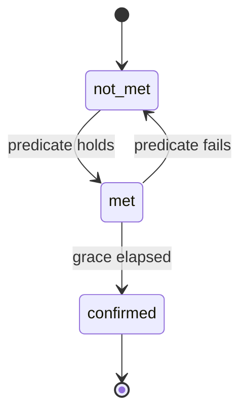

<!-- machine: order -->
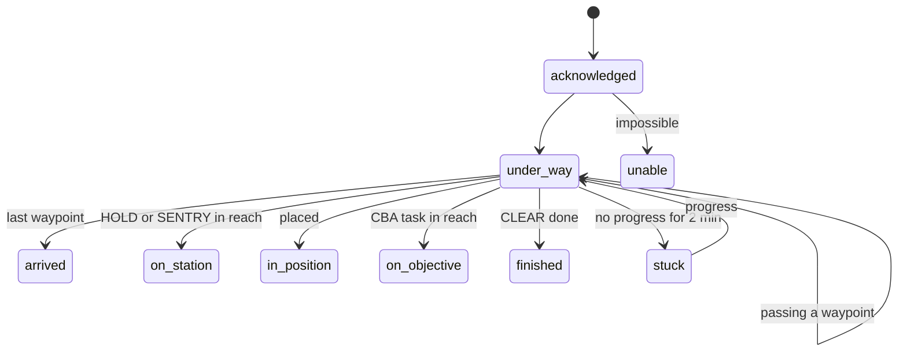

<!-- machine: contact -->
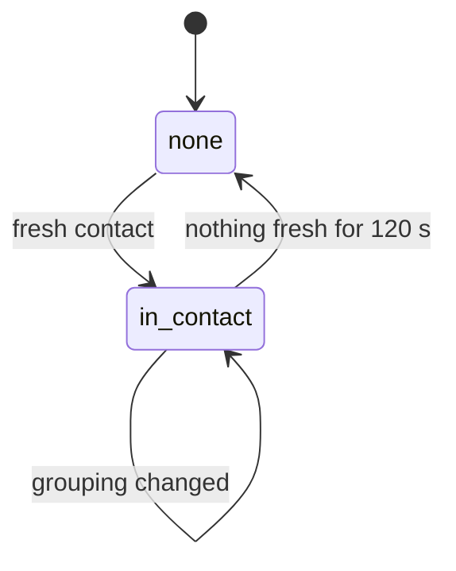

<!-- machine: casualty-list -->
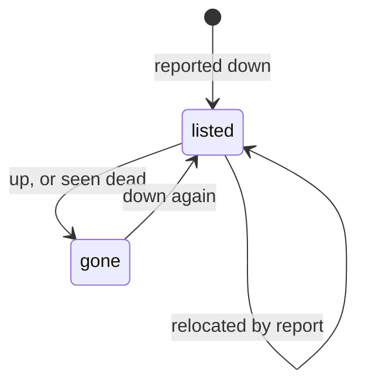

<!-- machine: apart -->
```mermaid
stateDiagram-v2
  [*] --> with_squad
  with_squad --> apart: beyond 100 m, not busy
  apart --> reported: 30 s
  apart --> with_squad: within 50 m
  reported --> with_squad: within 50 m
  apart --> [*]: down or aboard
  reported --> [*]: down or aboard
```

<!-- machine: outbox -->
```mermaid
stateDiagram-v2
  [*] --> said: calm, nothing queued
  [*] --> held: in combat, or queued behind
  held --> said: delay elapsed
  held --> [*]: mission ended or restarted
```

<!-- machine: server -->
```mermaid
stateDiagram-v2
  [*] --> none
  none --> loaded: battle set up
  loaded --> replaced: battle replaced or stopped
  replaced --> [*]
```
